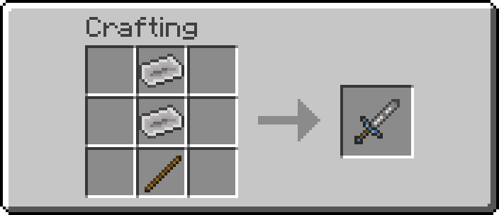
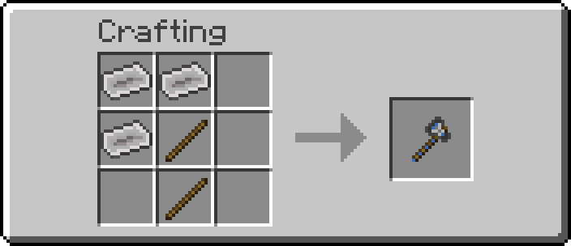
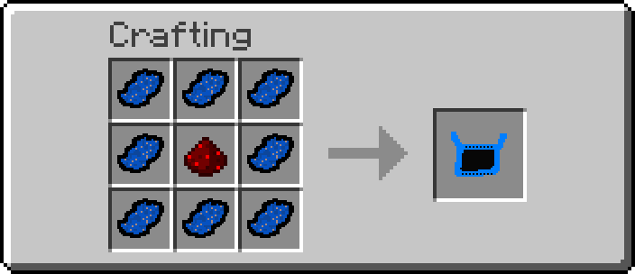
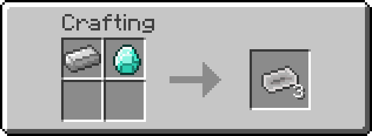
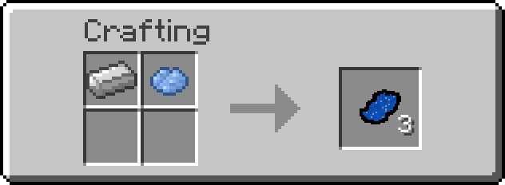

# FBI Gear

FBI gear, my very first mod, is a police themed mod including many diffrent items and features. The mod pairs well with the MrCrayfish Gun Mod.

## Features

- Night Vision Glasses
- Titanium Sword
- Titanium Axe
- Dyed Iron
- Etc

## Crafting

### Titanium Sword

### Titanium Axe

### Night Vision Glasses

### Titanium

### Dyed Iron

## Authors

- [@owenb135](https://www.github.com/owenb135)

## License

[Apache License 2.0](https://choosealicense.com/licenses/apache-2.0/)

## Contributing

Contributions are always welcome!

Go to Github to find out some ways to help.

